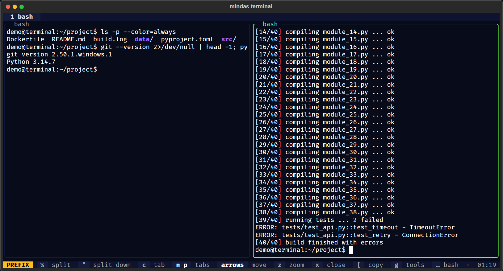
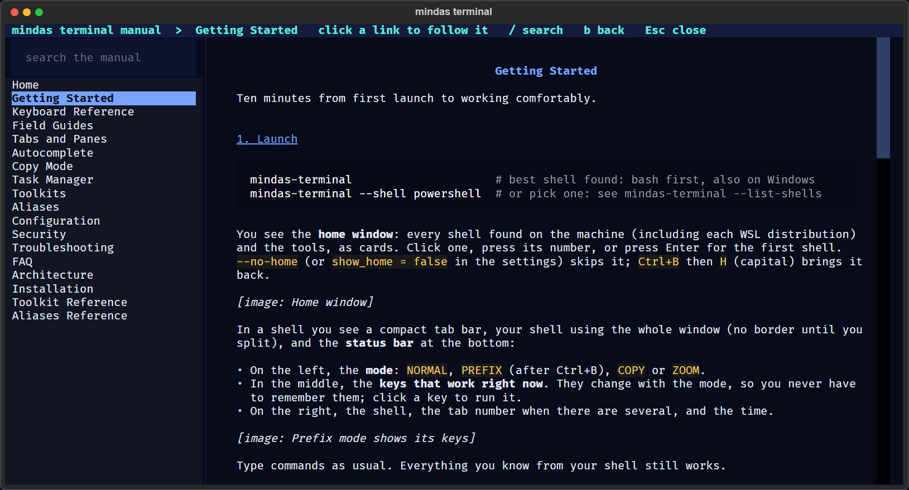
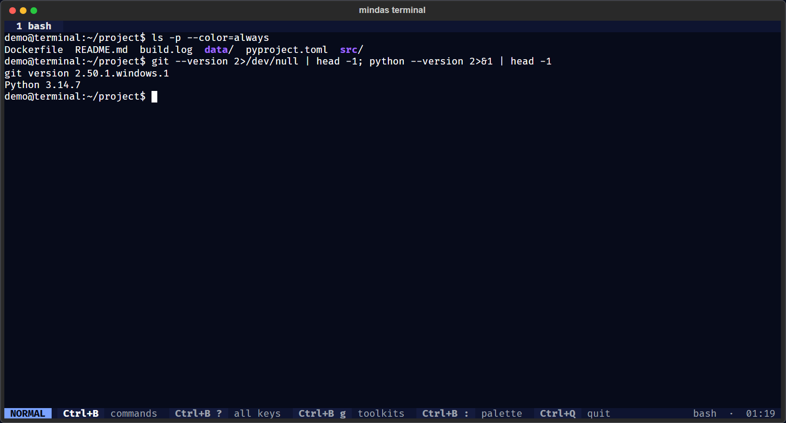
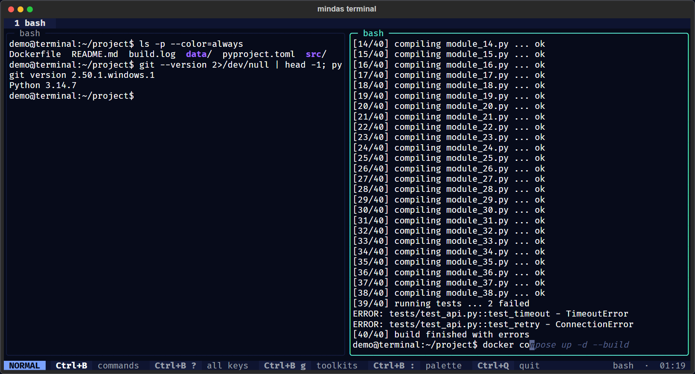
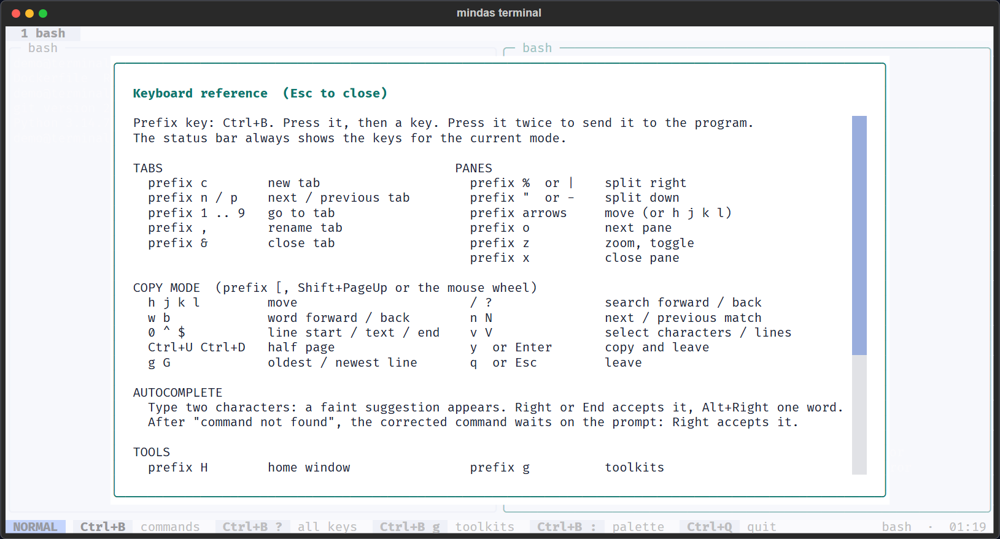

# mindas terminal


**A universal terminal for Windows and Linux, built for people who work in terminals all day.**
Real shells with bash first everywhere, tabs and split panes with tmux-style keys, vim-style copy mode, a task
manager with GPU use, and offline toolkits of curated commands for DevOps, HPC, AI, data, security,
IT support and project management.


## Why

- **Same habits on every machine.** On Windows it starts Git Bash (or WSL) by default, and can give PowerShell
  the Linux command names too, so `ls`, `grep`, `which`, `df` and your muscle memory work everywhere.
- **tmux and vim keys built in.** Splits, zoom, tabs and a searchable scrollback with vim motions, without
  installing anything else.
- **The right command, when you need it.** 109 curated commands across 11 fields, searchable offline,
  inserted at your prompt and never run behind your back.
- **Safe by design.** Paste-injection protection, no answer-back attacks, no telemetry, no network access,
  nothing written to disk except the settings you save.

## Features

| | |
|---|---|
| **Autocomplete** | Suggestions as you type from your history, common tools and toolkits; Right arrow accepts |
| **Smart hints** | "Did you mean" after a mistyped command, ready to accept with one key |
| **Shells** | Git Bash, MSYS2, WSL, PowerShell 7, Windows PowerShell, cmd on Windows; bash, zsh, fish, sh on Linux |
| **Tabs and panes** | Prefix key (Ctrl+B), split right or down, move with arrows or `h j k l`, zoom, rename, close safely |
| **Copy mode** | 10,000 lines of scrollback per pane, vim motions, smartcase search, character and line selection, clipboard |
| **Task manager** | CPU, memory and NVIDIA GPU per process, sort, filter, "only this terminal", terminate or kill with confirmation |
| **Toolkits** | Commands for 11 fields, placeholders filled with safe quoting, profiles that put your field first |
| **Aliases** | 89 opt-in aliases and helpers for bash and PowerShell, including Linux command names for PowerShell |
| **Home window** | Clickable start screen: every shell and WSL distribution, tools, system info, tips |
| **Guided keys** | A status bar that shows the keys for the current mode (normal, prefix, copy, zoom); click any of them |
| **Clickable** | Cards, tabs, panes, status-bar keys, manual pages and links all respond to the mouse |
| **Manual** | Full offline manual inside the app (`Ctrl+B` `m`), searchable, plus a classic man page (`--man`) |
| **Command palette** | Every action, new tabs per shell, themes, prefix keys, profiles, save settings |
| **Themes** | Space (default), light, high contrast |
| **Full-screen programs** | vim, less, htop, top and others, with the shell screen restored when they exit |

| Split panes | Prefix mode shows its keys |
|---|---|
|  |  |

| Manual inside the app | One pane, no borders |
|---|---|
|  |  |

| Copy mode with search | Toolkits |
|---|---|
|  |  |

| Autocomplete | Light theme and keyboard help |
|---|---|
|  |  |

## Install

Requires Python 3.11 or newer and [uv](https://docs.astral.sh/uv/) (or pipx).

```bash
uv tool install git+https://github.com/98-Anas/mindas_terminal
mindas-terminal
```

On Windows, install [Git for Windows](https://git-scm.com/download/win) first to get bash; run the app in
Windows Terminal for the best result. Full instructions, including offline installs:
[Installation](docs/Installation.md).

## Quick start

| Do this | Keys |
|---|---|
| Split side by side / top and bottom | `Ctrl+B` `%` / `Ctrl+B` `"` |
| Move between panes | `Ctrl+B` + arrow |
| Zoom a pane | `Ctrl+B` `z` |
| New tab / next tab | `Ctrl+B` `c` / `Ctrl+B` `n` |
| Scroll back, search, copy | mouse wheel or `Ctrl+B` `[`, then `/text`, `v`, `y` |
| Find a command for your field | `Ctrl+B` `g` |
| Task manager | `Ctrl+B` `t` |
| Home window / manual | `Ctrl+B` `h` / `Ctrl+B` `m` |
| Command palette | `Ctrl+B` `:` |
| All keys | `Ctrl+B` `?` |
| Quit | `Ctrl+Q` |

```bash
mindas-terminal --profile hpc               # your field first in the toolkits
mindas-terminal --shell powershell          # a specific shell
mindas-terminal --theme contrast            # high contrast
eval "$(mindas-terminal --aliases bash)"    # try the aliases in bash
mindas-terminal --init-config               # create a settings file
```

## For your field

| Field | Start with |
|---|---|
| DevOps and cloud | `--profile devops`; `dps`, `dlog`, `kbad`, *Terraform: review a plan* |
| HPC | `--profile hpc`; `sq`, `sgpu`, *Why a job is pending* |
| AI and ML | `--profile ai`; GPU sort in the task manager, `gpuw`, `torchok` |
| Data engineering | `--profile data-eng`; `sql`, *Parquet schema*, *CSV to Parquet* |
| Data science | `--profile data-sci`; *Start JupyterLab*, *Missing values per column* |
| Cybersecurity | `--profile security`; *Listening services*, *TLS certificate*, *Secrets committed to git* |
| IT support | `--profile linux` or `windows`; *Recent system errors*, *Who is using a port* |
| Networking | `--profile network`; *Is a TCP port open*, `certexp` |
| IT project management | `--profile pm`; *Commits this week*, *Release notes since the last tag* |

Recommended layouts and workflows: [Field Guides](docs/Field-Guides.md).

## Documentation

The full documentation is in [docs/](docs/Home.md), also published as the project wiki.

| | |
|---|---|
| [Getting Started](docs/Getting-Started.md) | First ten minutes |
| [Keyboard Reference](docs/Keyboard-Reference.md) | Every key on one page |
| [Tabs and Panes](docs/Tabs-and-Panes.md), [Copy Mode](docs/Copy-Mode.md), [Task Manager](docs/Task-Manager.md) | Features in depth |
| [Toolkits](docs/Toolkits.md), [Aliases](docs/Aliases.md) | Commands and helpers, with full references |
| [Configuration](docs/Configuration.md) | Settings file, options, themes |
| [Security](docs/Security.md) | Threat model and protections |
| [Architecture](docs/Architecture.md) | How it works, for contributors |
| [Troubleshooting](docs/Troubleshooting.md), [FAQ](docs/FAQ.md) | Help |

## Security and ethical use

mindas terminal opens no network connections, sends no telemetry and keeps scrollback in memory only. It
removes control and invisible characters from pastes, asks before a paste would run several commands, never
echoes attacker-controlled data back to your shell, and never looks up programs in the current folder.
Details and the threat model: [Security](docs/Security.md).

It is made for engineers, administrators, analysts, researchers, students and **authorised** security
testers. Use the security toolkit only on systems you own or are authorised in writing to test.

Report vulnerabilities privately: see [SECURITY.md](SECURITY.md).

## Performance

Measured with 100,000 lines through bash: 10,000 to 15,500 lines per second on Windows (ConPTY), 56,000 to
80,000 on Linux. Details: [Architecture](docs/Architecture.md#performance-notes).

## Development

```bash
git clone https://github.com/98-Anas/mindas_terminal && cd mindas_terminal
uv sync
uv run pytest                          # unit, screen-model and app tests with real shells
uv run python tools/e2e.py             # end-to-end checks: throughput, vim, Ctrl+C, resize
uv run python tools/gen_docs.py        # regenerate the reference pages after changing toolkits or aliases
uv run python tools/screenshots.py     # documentation screenshots from a demo environment (needs Chrome or Edge)
uv run python tools/ci.py --full --linux   # local CI: every gate, on Windows and Linux (WSL)
```

Quality gates run locally with `tools/ci.py`: tests, docs in sync with the code, lint with security rules,
a dependency vulnerability audit, end-to-end checks with real shells, and the same on Linux through WSL.
No hosted CI service is used.

See [CONTRIBUTING.md](CONTRIBUTING.md). Contributions of new toolkit fields are especially welcome.

## Status and roadmap

Version 0.1 is usable every day on Windows and Linux. Next: shell integration (command blocks, exit codes,
current folder), fuzzy history and directory jumping, a file panel, saved layouts and sessions,
SSH profiles, and community toolkit packs. Ideas and reports are welcome in the issues.

## License

Apache License 2.0. See [LICENSE](LICENSE).

Made by Anas Ayman Elgallad. Sharing knowledge is how it grows.
