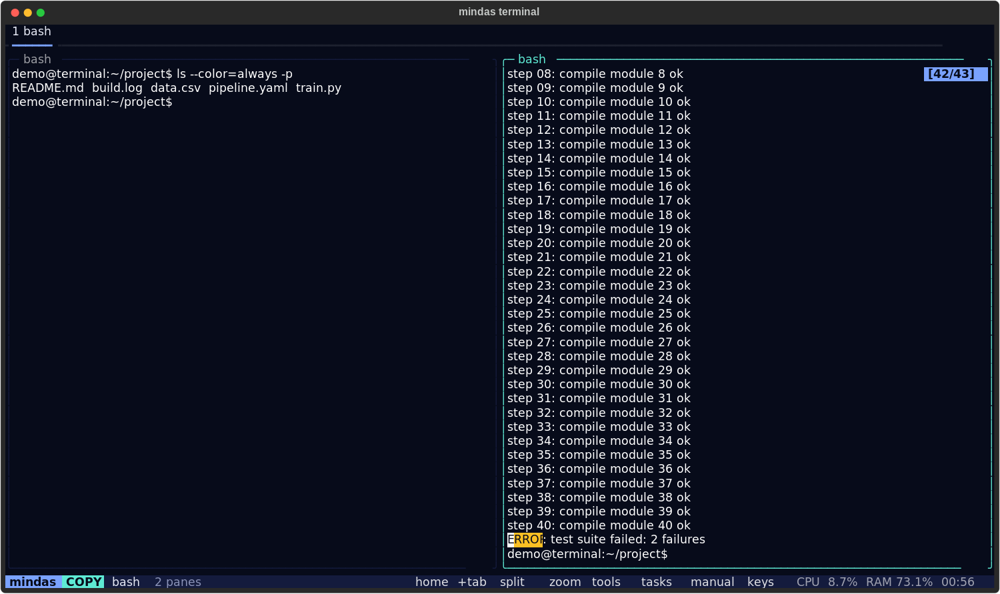

# Copy Mode

Copy mode lets you read, search and copy everything a pane has printed, using the keyboard.

## Entering and leaving

| Enter | Leave |
|---|---|
| `prefix [` | `q` |
| `Shift+PageUp` | `Esc` (first clears a selection) |
| Mouse wheel up | Mouse wheel down past the end |
|  | `y` or `Enter` after copying |

While in copy mode, the pane is **frozen**: output that keeps arriving is still recorded, but the view does not
jump. The badge at the top right shows your line and the total, for example `[64/67]`. The status bar shows `COPY`.

## Scrollback

Each pane keeps the last **10,000 lines** by default (`--scrollback`, or `scrollback` in the settings file;
0 turns it off). Scrollback lives **only in memory**; nothing is written to disk. `clear` in bash erases the
screen and the scrollback.

Full-screen programs (vim, less, htop, top) use a separate screen that does not add to the scrollback, and the
shell's screen comes back when they exit. In those programs the mouse wheel sends arrow keys instead.

## Moving

| Keys | Moves |
|---|---|
| `h` `j` `k` `l`, arrows | One character or line |
| `w` / `b` | Word forward / back |
| `0`, `^`, `$` | Line start, first non-blank, line end |
| `H`, `M`, `L` | Top, middle, bottom of the view |
| `Ctrl+U` / `Ctrl+D` | Half page |
| `Ctrl+B` / `Ctrl+F`, `PageUp` / `PageDown` | Full page |
| `Ctrl+Y` / `Ctrl+E` | Scroll one line, cursor stays |
| `g` / `G`, `Home` / `End` | Oldest / newest line |

## Searching

Press `/` (forward) or `?` (backward), type, then Enter. The prompt appears on the last line of the pane.
Every match is highlighted; `n` and `N` move between them, wrapping around.

Search is **smartcase**, as in vim: `error` matches `Error` and `ERROR`, but `Error` matches only `Error`.

## Selecting and copying

1. Move to where the text starts.
2. Press `v` for a character selection or `V` for whole lines.
3. Move to where it ends.
4. Press `y` (or Enter).

The text goes to the **system clipboard** and to an internal buffer. Paste it in any pane with `prefix ]`, or
anywhere else with your system's paste. Without a selection, `y` copies the current line.

The system clipboard is reached through the host terminal (OSC 52). Windows Terminal and most modern Linux
terminals support it. If yours does not, `prefix ]` still works inside mindas terminal.

## Examples

- **Find the first error of a long build:** `prefix [`, `g`, `/error` Enter.
- **Copy a stack trace:** search for `Traceback`, `V`, `j` until the end, `y`.
- **Copy a job ID from `sbatch` output:** `prefix [`, `k` to the line, `w` to the number, `v`, `$`, `y`.
