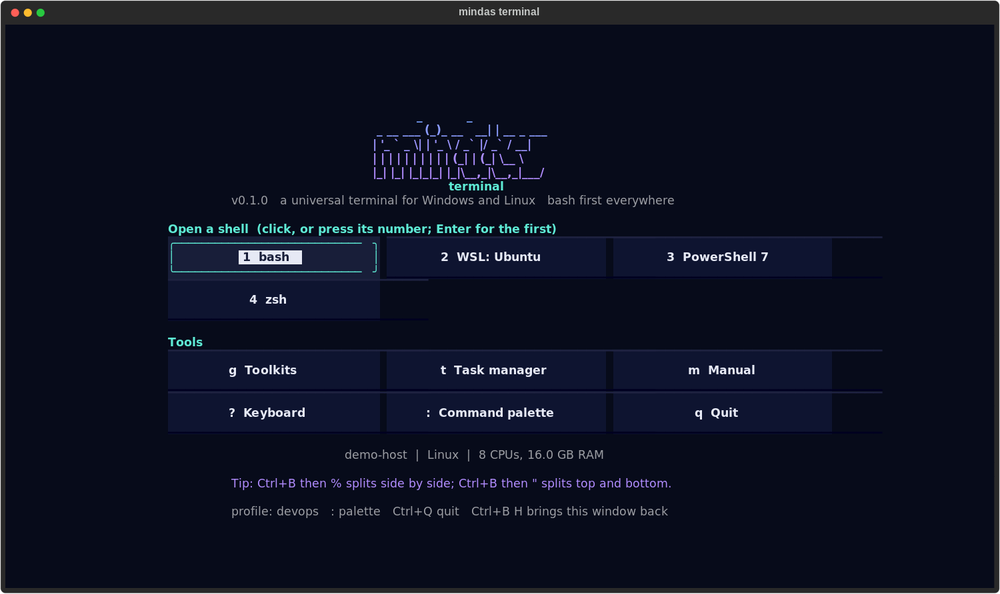

# Getting Started

Ten minutes from first launch to working comfortably.

## 1. Launch

```bash
mindas-terminal                     # best shell found: bash first, also on Windows
mindas-terminal --shell powershell  # or pick one: see mindas-terminal --list-shells
```

You see the **home window**: every shell found on the machine (including each WSL distribution) and the
tools, as cards. Click one, press its number, or press Enter for the first shell. `--no-home` (or
`show_home = false` in the settings) skips it; `Ctrl+B` then `H` (capital) brings it back.



In a shell you have one tab, one pane, and a status bar at the bottom. The words in the middle of the status
bar are **clickable**: `home`, `+tab`, `split`, `zoom`, `tools`, `tasks`, `manual`, `keys`.

Type commands as usual. Everything you know from your shell still works.

## 2. The prefix key

Terminal programs need almost every key, so the terminal's own commands start with a **prefix key**:
press **Ctrl+B**, release it, then press the command key. This is the same idea as tmux.

| Try | Result |
|---|---|
| `Ctrl+B` then `%` | split the pane side by side |
| `Ctrl+B` then `"` | split it top and bottom |
| `Ctrl+B` then an arrow | move to the pane in that direction |
| `Ctrl+B` then `z` | zoom the current pane (again to restore) |
| `Ctrl+B` then `c` | new tab |
| `Ctrl+B` then `?` | the full keyboard reference |

While the prefix is armed, the status bar shows a yellow `Ctrl+B` badge. Press `Ctrl+B` twice to send a
real Ctrl+B to the program. You can change the prefix to Ctrl+A or another key; see [Configuration](Configuration).

## 3. Scroll back and copy

Scroll with the mouse wheel, or press `Shift+PageUp`, or `Ctrl+B` then `[`. This is **copy mode**: the output
is frozen so you can read it, and you move with vim keys (`j`/`k`, `Ctrl+U`/`Ctrl+D`, `g`/`G`).

- `/error` then Enter finds "error" (case-insensitive unless you type a capital letter); `n` finds the next one.
- `v` starts a selection, `V` selects whole lines, `y` copies to the clipboard.
- `q` or `Esc` goes back to live output.

Details: [Copy Mode](Copy-Mode).

## 4. Find the right command

`Ctrl+B` then `g` opens the **toolkits**: commands for Linux and Windows support, networking, Git, DevOps,
HPC and Slurm, AI and ML, data engineering, data science, security and project management.

Type a few words, for example `docker logs` or `slurm gpu` or `tls cert`, and press Enter. If the command has
placeholders such as `<host>`, you are asked for each value. The command is then typed at your prompt and
**not run**, so you can check it and press Enter yourself.

Start with your own field first: `mindas-terminal --profile hpc` (or pick `Profile: ...` in the command palette).
Details: [Toolkits](Toolkits).

## 5. Watch your machine

`Ctrl+B` then `t` opens the **task manager**: CPU, memory and GPU per process. Press `f` to show only what is
running inside this terminal, `/` to filter, `c`/`m`/`g` to sort, `k` to end a process (it asks first).
Details: [Task Manager](Task-Manager).

## 6. Everything else from one place

`Ctrl+B` then `:` opens the **command palette**. Type to search every action: new tabs with a specific shell,
themes, prefix keys, profiles, and *Save settings* to keep your choices.

## 7. Optional: helpful aliases

```bash
mindas-terminal --aliases list                 # see what is available
eval "$(mindas-terminal --aliases bash)"       # try them now in bash
```

You get shortcuts such as `mkcd`, `up 3`, `extract`, `ports`, `gs`, `dps`, `sq`, `gpu`, and on PowerShell also
Linux names such as `touch`, `which`, `grep`, `head`, `df`. Details: [Aliases](Aliases).

## 8. The manual, always with you

`Ctrl+B` then `m` opens this manual inside the app, offline. Click a page or a link, type to search, `b` goes
back. On Linux, `mindas-terminal --man | man -l -` shows the classic man page; see [Installation](Installation)
to install it for `man mindas-terminal`.

## Next

- [Field Guides](Field-Guides): a recommended set-up for your role.
- [Keyboard Reference](Keyboard-Reference): everything on one page.
