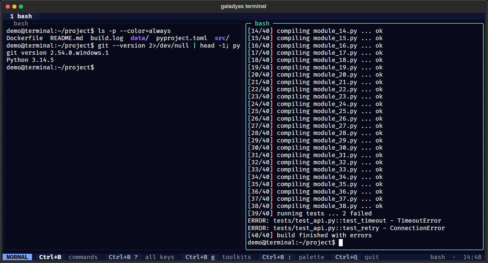

# Tabs and Panes

Each **tab** holds one or more **panes**. Each pane runs its own shell. Panes are arranged in columns:
split right adds a column, split down adds a pane inside the current column.

## The prefix key

Press `Ctrl+B`, release, then a command key. The status bar shows a yellow badge while the prefix is armed.
The next key is consumed by the terminal, so a mistyped command key does nothing harmful. To send `Ctrl+B`
to the program (bash uses it to move the cursor back), press it twice.

Change it with `--prefix ctrl+a`, in the settings file, or from the command palette (`Prefix key: ...`).

## Splitting

| Keys | Layout |
|---|---|
| `prefix %` or `prefix \|` | New column to the right of the current pane |
| `prefix "` or `prefix -` | New pane below the current pane, same column |

The new pane starts the same shell as the current one. To start a different shell, open a tab from the
palette: `New tab: PowerShell`, `New tab: WSL bash`, and so on.

## Moving and zooming

- `prefix` + arrow (or `h` `j` `k` `l`) moves to the neighbouring pane.
- `prefix o` cycles through the panes of the tab.
- `prefix z` zooms the current pane to fill the tab. The status bar shows `ZOOM`. Press again to restore.
- Clicking a pane with the mouse focuses it. The focused pane has a bright border.

## Titles

Programs can set a title (Git Bash shows the current folder, vim shows the file). The title appears on the
pane border and in the tab label. Rename a tab with `prefix ,`; an empty name returns to automatic titles.
Titles are cleaned of control characters and limited to 60 characters (see [Security](Security)).

## Closing

- Type `exit` in a shell, or press `Ctrl+D` at an empty bash prompt: the pane closes.
- `prefix x` closes the current pane, `prefix &` the current tab. Both ask first, because the programs
  inside end too.
- When the last pane closes, the app exits. `Ctrl+Q` quits at once when only one pane is open, and asks
  when there are more.

## Tips for remote and long-running work

- Running an SSH session inside a pane works normally. For sessions that must survive a disconnect, run
  `tmux` or `screen` on the remote side; galadyas terminal passes their keys through (choose a different
  prefix for one of them, for example `--prefix ctrl+a` here and `Ctrl+B` in remote tmux).
- On HPC login nodes, keep one pane for `squeue` and one for your work: `prefix "` then `watch -n 30 squeue -u $USER`.
