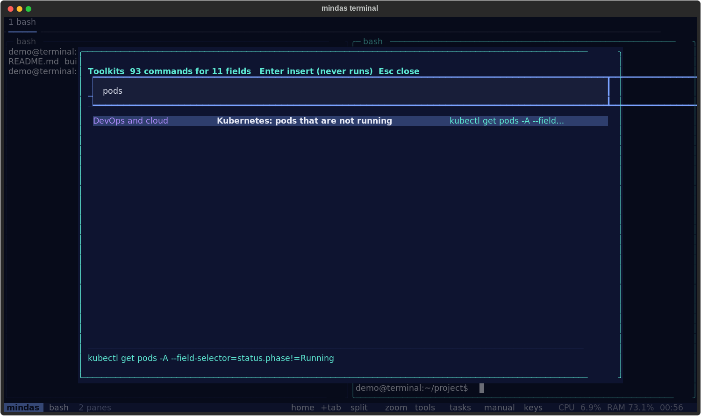

# Toolkits

Curated, offline commands for eleven fields, searchable from inside the terminal. They save looking up flags
you use once a month, and they teach: each entry says what it does in plain words.



## Using them

1. `prefix g` (or *Toolkits* in the command palette).
2. Type words in any order: `docker logs`, `slurm gpu`, `parquet schema`, `failed logins`, `release notes`.
   Every word must appear in the field, the title or the command.
3. `Up`/`Down` to choose; the bottom panel shows the full command and notes.
4. `Enter`. If the command has placeholders such as `<host>` or `<jobid>`, you are asked for each one.
   Leave a value empty to keep the placeholder and edit it at the prompt.
5. The command appears at your prompt. **It does not run.** Read it, then press Enter yourself.

Only commands for your platform are shown: PowerShell versions on Windows where they differ, Linux versions
on Linux. Commands marked `any` work in bash on both (Git Bash on Windows).

## Fields and profiles

| Profile | Field |
|---|---|
| `linux` | Linux and IT support |
| `windows` | Windows administration |
| `network` | Networking |
| `git` | Git and code review |
| `devops` | DevOps and cloud: Docker, Kubernetes, Terraform, Ansible |
| `hpc` | HPC and Slurm |
| `ai` | AI and ML engineering |
| `data-eng` | Data engineering: DuckDB, Parquet, jq, PostgreSQL |
| `data-sci` | Data science: Jupyter, pandas |
| `security` | Cybersecurity, defensive and authorised testing |
| `pm` | IT project management: progress, releases, issues |

A **profile** lists your field first. Set it with `--profile hpc`, `profile = "hpc"` in the settings file,
or `Profile: ...` in the command palette. You still see every field.

The full list is in the [Toolkit Reference](Toolkit-Reference).

## Placeholders and quoting

Values you type are made safe before they are inserted:

- Control characters are removed, so a value can never add a newline (which would run the command) or an
  escape sequence.
- A value with spaces or shell symbols is wrapped in single quotes, so it stays **one argument** in bash, zsh
  and PowerShell. A single quote inside a value is dropped, because it would end the quoting.
- Where the command already puts the placeholder in quotes (for example a file name inside an SQL string),
  the value goes inside those quotes, minus any character that would close them.

Examples:

| Command | Value | Inserted |
|---|---|---|
| `nc -zv <host> <port>` | `db.internal` | `nc -zv db.internal <port>` (next you are asked for `<port>`) |
| `grep -rn --color '<text>' <dir>` | `disk full` | `grep -rn --color 'disk full' <dir>` |
| `duckdb -c "SELECT * FROM '<file>' LIMIT 20"` | `sales 2026.csv` | `duckdb -c "SELECT * FROM 'sales 2026.csv' LIMIT 20"` |

## Ethical use

The security toolkit is for **defence and for testing systems you own or are authorised in writing to test**:
auditing your own machine, checking certificates, verifying downloads, reviewing logins, scanning your own
network. Commands that scan carry this notice in the app. Unauthorised scanning or access is illegal in most
countries. See [Security](Security).

## Adding commands

Toolkits are plain data in `src/mindas_terminal/toolkit.py`. Each entry is one line:

```python
T("hpc", "Why a job is pending", "squeue -j <jobid> -o '%i %T %r'"),
```

Fields: field key, title (what it does, in plain words), command, optional note, optional platform
(`any`, `linux` or `windows`). Run `uv run python tools/gen_docs.py` to refresh the reference page, then the
tests. Contributions for new fields are welcome; see [Contributing](https://github.com/98-Anas/mindas_terminal/blob/main/CONTRIBUTING.md).
